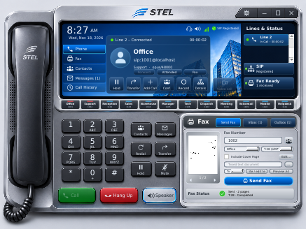

<h1 align="center">Stel</h1>

سافت‌فون ویندوز و لینوکس، بر پایهٔ liblinphone

<a href="https://seifzadeh.github.io/stel/?lang=fa">وب‌سایت</a> · <a href="https://github.com/seifzadeh/stel/releases">دریافت برنامه</a> · <a href="README.md">English</a>

با Stel اکانت‌های PBX خودت را روی دسکتاپ داشته باش؛ تماس صوتی و تصویری بگیر،
پیام رد و بدل کن و فکس بفرست یا دریافت کن. برنامه با Qt و C++ ساخته شده است.

[تصاویر همهٔ صفحه‌ها](docs/SCREENSHOTS.md#captured-pages) · [گالری سایت](https://seifzadeh.github.io/stel/?lang=fa#screenshots)

## قابلیت‌ها

1. **بر پایهٔ liblinphone** 
   ارتباط SIP، صدا و تصویر با هستهٔ Linphone؛ رابط دسکتاپ هم با <bdi dir="ltr">Qt/C++</bdi> ساخته شده است.

2. **مدیریت چند اکانت، بدون محدودیت تعداد** 
   همزمان به چند PBX وصل شو. در تنظیمات، اکانت‌ها را اضافه، ویرایش یا حذف کن،
   Register و Unregister بزن و نتیجهٔ رجیستر هرکدام را همان‌جا ببین.

3. **جداسازی سیگنال و مدیا** 
   برای SIP یک IP و برای صدا و تصویر IP دیگری انتخاب کن. پورت SIP و محدودهٔ
   پورت‌های مدیا هم جدا تنظیم می‌شوند؛ مناسب سیستم‌هایی که چند کارت شبکه دارند.

4. **تماس صوتی و تصویری** 
   تماس‌ها روی صفحهٔ اصلی می‌مانند؛ پاسخ و رد، DTMF، نگه‌داشتن تماس،
   بستن میکروفون، ضبط، انتقال، فوروارد و کنفرانس از همان‌جا در دسترس هستند.
   تصویر در گوشهٔ LCD نمایش داده می‌شود؛ با کلیک بزرگش کن و بدون قطع تماس برگرد.
   [راهنمای کنترل تماس](docs/CALLS.md).

5. **ارسال و دریافت پیام** 
   برای هر اکانت، با SIP MESSAGE چت کن. تاریخچه و پیام‌های خوانده‌نشده را ببین؛
   متن فارسی، انگلیسی و ترکیب آن‌ها درست نمایش داده می‌شود.

6. **ارسال و دریافت فکس** 
   برای هر فکس، T.38 یا G.711 pass-through انتخاب کن؛ پیش‌فرض T.38 است.
   متن بنویس یا PDF، TXT، TIFF، PNG و JPEG بده. برنامه صفحات را به A4 تبدیل می‌کند
   و پیش‌نمایش می‌دهد. فکس‌های دریافتی هم در جدول جداگانه، با امکان بازکردن و ذخیره، دیده می‌شوند.

7. **انتخاب کدک‌های صوتی و تصویری** 
   کدک‌ها را در تنظیمات فعال کن و اولویت بده. صدا شامل G.729، Opus، G.711 و G.722
   و تصویر شامل H.264، VP8 و AV1 است. فهرست، کدک‌های موجود در همان بیلد را نشان می‌دهد.

8. **TLS دوطرفه** 
   برای هر اکانت، گواهی و کلید کلاینت تعریف کن؛ گواهی سرور هم بررسی می‌شود.
   سیگنالینگ از UDP، TCP و TLS پشتیبانی می‌کند. رسانه به‌صورت پیش‌فرض RTP است
   و SRTP را می‌توانی جداگانه در تنظیمات اکانت انتخاب کنی.

چند ابزار دیگر:

- [رابط با نصف اندازه](docs/DISPLAY.md)؛ پنجره، نوشته و دکمه‌های کوچک‌تر، با پشتیبانی از Scale ویندوز.

- [کنترل از راه دور با API](docs/API.md): فرمان‌های ییلینک و API با خروجی JSON برای تماس، اکانت، پیام، فکس، BLF و وضعیت برنامه؛ فعال‌سازی در Settings → Remote API.

- [پنل ۱۲ کلیدی Expansion](docs/EXPANSION.md): شماره‌گیری فوری و BLF؛ داخلی آزاد
  سبز و داخلی مشغول قرمز است. نام، اکانت و شمارهٔ هر کلید را خودت تنظیم کن.
- پاسخ خودکار و Caller ID Name مستقل برای هر اکانت.
- [دریافت Paging و اینترکام](docs/PAGING.md) با Alert-Info؛ تنظیم میکروفون و بوق برای هر اکانت.
- میکروفون و دوربین مجازی برای تست بدون دستگاه واقعی.
- مخاطبین، سابقهٔ تماس و ذخیرهٔ امن رمزها.

ارسال پیام، فکس و انتقال تماس به پشتیبانی PBX و طرف مقابل هم نیاز دارند.

## شروع کار

1. از [Releases](https://github.com/seifzadeh/stel/releases)، فایل **Setup.exe** ویندوز یا **deb / rpm** لینوکس را بگیر و نصب کن. نسخه‌های قابل حمل exe و run هم موجودند و کتابخانه‌ها همراه برنامه هستند. [راهنمای نصب](docs/INSTALLING.md)

2. به **Settings → Accounts → Add account** برو، اطلاعات SIP را وارد کن و **Register** بزن. وضعیت سبز یعنی اکانت رجیستر شده است.

3. از تب **Phone**، **Messages** یا **Fax** استفاده کن و اکانت موردنظرت را انتخاب کن.

نسخه‌های سیستم‌عامل در یادداشت ریلیز و [راهنمای ساخت](docs/BUILDING.md) توضیح داده شده‌اند.
برای تنظیمات و فرمت‌های فکس، [راهنمای فکس](docs/FAX.md) را ببین.

## سورس و توسعه

سورس در [seifzadeh/stel](https://github.com/seifzadeh/stel) است.
راهنمای [ساخت](docs/BUILDING.md)، [مشارکت](CONTRIBUTING.md) و
[انتشار](docs/RELEASE.md) در ریپو قرار دارد. GitHub Actions بسته‌های ویندوز و
لینوکس را می‌سازد، تست می‌کند و سپس ریلیز را منتشر می‌کند.

## توسعه‌دهنده و مجوز

**Mehrdad Seifzadeh** 
<mehrdad.seifzadeh@gmail.com> · [github.com/seifzadeh](https://github.com/seifzadeh)

کد و نشان Stel تحت **GPL-3.0-or-later** است؛ می‌توانی از آن استفاده کنی، تغییرش
بدهی و منتشرش کنی. مجوز کتابخانه‌ها، از جمله AGPL در liblinphone، حفظ می‌شود.
جزئیات در [LICENSE](LICENSE) و [مجوز کتابخانه‌ها](THIRD_PARTY.md) آمده است.
