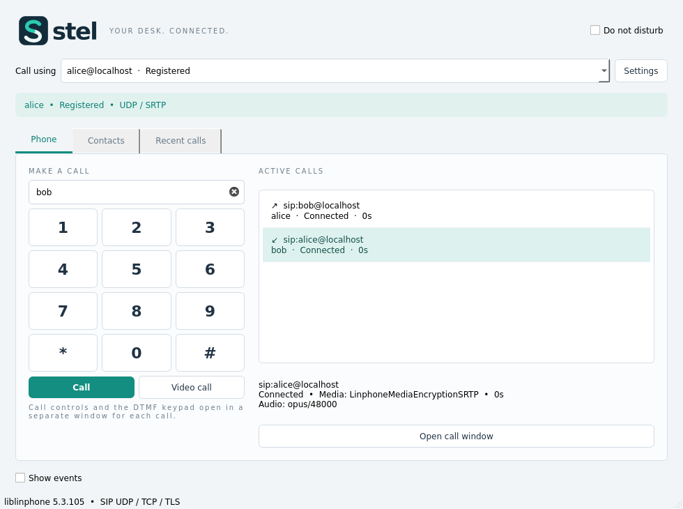

<h1 align="center">Stel</h1>

A compact, open-source, multi-account SIP softphone built with Qt and liblinphone.

<a href="https://seifzadeh.github.io/stel/">Website</a> · <a href="https://github.com/seifzadeh/stel/releases">Downloads</a> · <a href="README.fa.md">فارسی</a> · <a href="docs/BUILDING.md">Build</a> · <a href="docs/RELEASE.md">Release guide</a>

Stel provides voice and video calling, multiple SIP accounts, a separate dialog
for each call, DTMF, hold, blind/attended transfer, forwarding and conferencing.
Settings include live account registration status, per-account Auto Answer and
Caller ID Name, audio/video codec preferences, network binding and dummy devices
for testing without a physical microphone or camera. Settings → About shows the
application version and dependency credits.

SIP UDP/TCP/TLS and client-certificate authentication are supported. New accounts
use RTP; SRTP is an explicit account setting. WebRTC-compatible media settings are
available for compatible SIP gateways; generic WSS signalling and SIP-over-SCTP
are **not implemented**. Codec availability is discovered from the actual SDK.

## Downloads and compatibility

Use the native Linux `.run` or Windows portable `.exe` from
[Releases](https://github.com/seifzadeh/stel/releases). Application libraries,
plugins, public trust roots and notices are bundled; no shell launcher or manual
library loading is needed. The runtime is bundled, **not fully statically linked**.
OS loaders, drivers and desktop/audio services remain system components.

- Linux x86_64: built in Debian 13; the exact minimum glibc is recorded in each
  bundle's `bundle-manifest.json`.
- Windows x64: Qt 5.15.2, MSVC v142, matching source-built SDK, CRT and UCRT.
  Actions tests run on Windows Server 2022. Windows 7 SP1/8.1 are legacy targets
  and require testing on those systems; that compatibility is not yet verified.
- macOS, 32-bit Windows and ARM packages are not provided by the current workflow.

## Development and releases

See [BUILDING](docs/BUILDING.md), [architecture](docs/ARCHITECTURE.md) and
[CONTRIBUTING](CONTRIBUTING.md). No PBX credentials are needed: native tests use
loopback accounts and generate their own TLS certificates.

`CMakeLists.txt` is the single version source. A push to `main` builds and tests
Linux and Windows. If that version has not been published, the successful workflow
creates its `vX.Y.Z` tag and release automatically, with native binaries, archives,
SHA-256 sums and matching source packages. Existing published versions are never
overwritten. See [RELEASE](docs/RELEASE.md) for the first push and Pages setup.

## Author and license

Principal developer: **Mehrdad Seifzadeh**  
<mehrdad.seifzadeh@gmail.com> · [github.com/seifzadeh](https://github.com/seifzadeh)

Stel's original source and artwork are **GPL-3.0-or-later**. You may use, modify
and redistribute them under the GPL. There is no warranty. Upstream components
retain their own licenses, including AGPLv3 for liblinphone and the vendored
Mediastreamer2 filters; those additional conditions apply to the combined work.
See [LICENSE](LICENSE), [NOTICE](NOTICE.md), [AGPL](LICENSES/AGPL-3.0.txt) and
[third-party notices](THIRD_PARTY.md).
