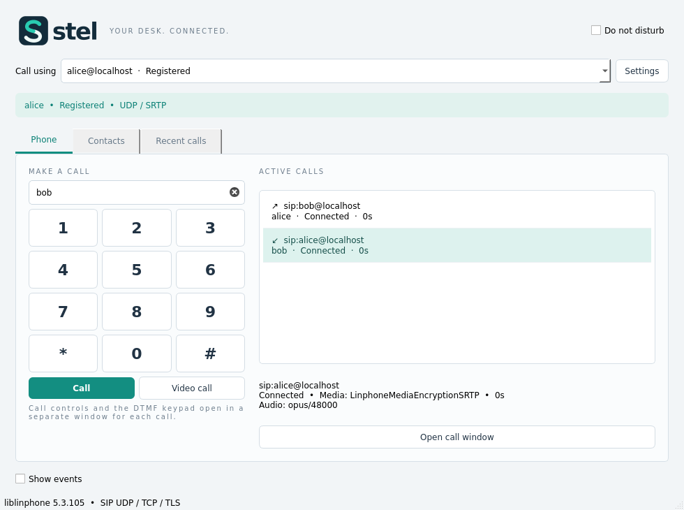

<h1 align="center">Stel</h1>

A SIP softphone for Windows and Linux, built on liblinphone.

<a href="https://seifzadeh.github.io/stel/">Website</a> · <a href="https://github.com/seifzadeh/stel/releases">Download</a> · <a href="README.fa.md">فارسی</a>

Stel brings your PBX accounts to the desktop. Make voice and video calls,
exchange messages, and send or receive faxes from a Qt/C++ application.

## Features

1. **Built on liblinphone** 
   Uses the Linphone SIP and media engine, with a desktop interface written in Qt/C++.

2. **Multiple accounts, with no fixed limit** 
   Connect to several PBXs at once. Add, edit, remove, register or unregister each
   account in Settings, and see its registration result immediately.

3. **Separate signalling and media** 
   Choose a local IP for SIP and another for audio/video. Set SIP ports and media
   port ranges separately, including on machines with multiple network interfaces.

4. **Voice and video calls** 
   Each call has its own window. Answer or reject calls, send DTMF, hold, mute,
   record, transfer, forward, or join calls in a conference.

5. **Messaging** 
   Send and receive SIP MESSAGE in a chat view for each account. Conversations
   have history and unread counts, with support for Persian, English and mixed text.

6. **Send and receive fax** 
   Choose T.38 (the default) or G.711 pass-through for each fax. Type text or
   select PDF, TXT, TIFF, PNG or JPEG; Stel prepares A4 pages and lets you preview
   them before sending. Received faxes appear in an inbox where you can open or save them.

7. **Audio and video codec selection** 
   Enable codecs and set their priority in Settings. Audio includes G.729, Opus,
   G.711 and G.722; video includes H.264, VP8 and AV1. The list shows the codecs
   available in your build.

8. **Mutual TLS** 
   Use TLS with a client certificate and private key for each account, alongside
   server certificate verification. SIP supports UDP, TCP and TLS; media is RTP
   by default, with SRTP available as an account setting.

Also included:

- Auto Answer and Caller ID Name for each account.
- Dummy microphone and camera for testing without physical devices.
- Local contacts, recent calls and secure password storage.

Messaging, fax and call transfers need support from your PBX and the other endpoint.

## Get started

1. Download the Windows `.exe` or Linux `.run` from [Releases](https://github.com/seifzadeh/stel/releases). Application libraries are included. On Linux, allow the file to run as a program.
2. Open **Settings → Accounts → Add account**, enter your SIP details and press **Register**. A green status shows a successful registration.
3. Use **Phone**, **Messages** or **Fax** and choose the account you want to use.

For OS requirements, check the release notes and [build guide](docs/BUILDING.md).
For fax setup and supported documents, see the [fax guide](docs/FAX.md).

## Source and development

The source is at [seifzadeh/stel](https://github.com/seifzadeh/stel).
See [Building](docs/BUILDING.md), [Contributing](CONTRIBUTING.md) and
[Release guide](docs/RELEASE.md). GitHub Actions builds and tests the Linux
and Windows packages before publishing a release.

## Developer and license

**Mehrdad Seifzadeh** 
<mehrdad.seifzadeh@gmail.com> · [github.com/seifzadeh](https://github.com/seifzadeh)

Stel's code and artwork are **GPL-3.0-or-later**. You can use, modify and share
this project under that license. Library licenses, including liblinphone's AGPL,
remain in place. See [LICENSE](LICENSE) and [third-party notices](THIRD_PARTY.md).
