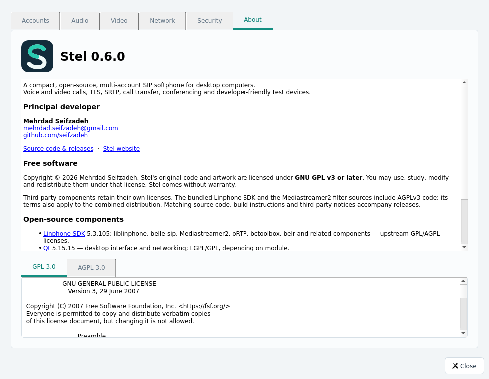

# Stel 0.6.0 — release-ready repository and About

Settings → About displays the application version, runtime Qt/liblinphone
versions, principal developer Mehrdad Seifzadeh, contact/project/site links,
open-source component credits and offline GPL/AGPL license texts. Windows
Explorer version resources are generated from the same CMake project version.
Original Stel code/artwork use GPL-3.0-or-later; upstream AGPL and other notices
are preserved. CLI --version bypasses Qt GUI message boxes; the Windows launcher
forwards redirected standard handles to the child application.

## Verified locally on 2026-11-09

- Qt 5 build and full native CTest: 3/3 groups pass in 119.53 seconds, with
  62 core results, 29 UI results and 8 TLS scenarios.
- Qt 6 compiles and its native startup smoke test passes.
- A focused packaged About test verifies version/credits and both embedded license texts.
- Linux dependency closure audit passes; 250 ELF files, minimum glibc 2.39.
- Native single-file application runs alone from a spaced/Persian path with
  development library/plugin variables removed.
- Four offline release tests pass: source-export secret/build exclusions, strict
  tag/version match, SHA-256 generation and refusal of local publication.
- actionlint 1.7.12 accepts both workflows. PowerShell's AST parser accepts every
  .ps1 script; Python compile checks and Bash syntax checks pass.
- Actual English/Persian desktop/mobile website renders are inspected. Headless
  Firefox DOM checks pass at 1440px and 390px: images, version, both download links,
  language/RTL switch, screenshot viewer open/close and no horizontal overflow.

Evidence is kept outside the exported repository in build/qa/release-prep-* logs.
The complete release-source tree is also built and tested from repo/ in a fresh
build directory: 3/3 groups pass in 119.81 seconds. This checks that no
application source/resource was omitted.

## Automated build boundary

GitHub Actions recipes build/test Debian 13 Linux x86_64 and Windows x64, collect
matching dependency sources, audit runtime dependencies and publish versioned
assets only after both builds succeed. The Pages workflow deploys the bilingual
static site. These workflows are prepared and locally linted; no remote workflow,
commit, tag, push, release or Pages-setting update was performed here.

Windows native compilation/runtime and the first hosted workflow remain untested
on this Linux host. Windows 7 SP1/8.1 require explicit VM/hardware validation;
the Windows 2022 Actions host alone cannot establish legacy compatibility.
Fully static linking is not claimed. The release guide explains the first push,
one-time Pages setup and subsequent version bumps.

Earlier account/call behavior: [0.5.3 report](TEST_REPORT_0.5.3.md).

## First hosted run and CI corrections

The first [build run](https://github.com/seifzadeh/stel/actions/runs/42614528864)
compiled Linux and passed TLS, but credential tests failed because its private
D-Bus session had no Secret Service. Windows stopped while installing the removed
MINGW64 yasm package. Qt installation also replaced Python 3.11 with 3.15, which
would have hidden the previously installed SDK build modules.

The Linux test wrapper now creates an isolated, unlocked GNOME keyring and checks
real store/read/delete operations before CTest. Password fallback remains disabled.
MSYS2 tools use the maintained UCRT64 repository and Qt reuses Python 3.11. The
loopback UI video peer uses disjoint RTP/RTCP ranges to avoid collisions between
independent endpoints sharing the same IP; video/frame/snapshot assertions remain.

All native groups pass without DISPLAY or WAYLAND_DISPLAY in this isolated
environment: core 81.76s, UI 25.39s, TLS 10.74s; 117.90s total. Release boundary
tests, actionlint, Bash and PowerShell syntax checks also pass.

The initial [Pages run](https://github.com/seifzadeh/stel/actions/runs/42614528914)
failed with a missing Pages site. Pages requires one-time repository enablement
with build type `workflow`; GITHUB_TOKEN cannot bootstrap that setting itself.
This is separate from the static site's build and content.
