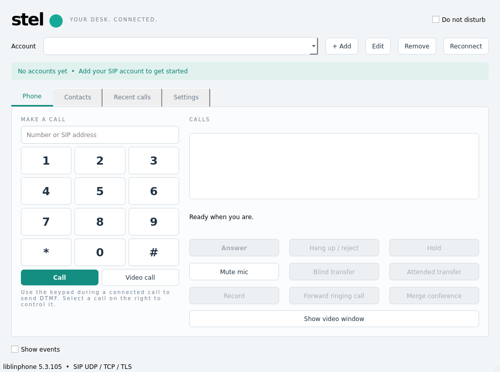

# Historical verification — version 0.1.0 — 2026-11-08

Host: Debian GNU/Linux 13, x86_64. GCC 14.2, CMake 3.31.6, Qt 5.15.15,
liblinphone 5.3.105. The Qt 6.8.2 application target also compiles successfully.
Windows executables and fully static executables were not produced on this host.

## Automated results

The final native CTest run passed both groups (17.09 seconds):

| Scenario | Evidence / result |
| --- | --- |
| Settings round trip | Account metadata restored; SIP, TURN and private-key passwords absent from disk |
| Invalid settings / destinations | Malformed settings preserved; unsupported transports and CR/LF destinations rejected |
| Audio | Two real liblinphone cores connect; receiver reports nonzero RTP download bandwidth |
| Controls and recording | Hold/resume, mute, DTMF received by peer, WAV file contains audio data |
| Encrypted video | Negotiated SRTP; nonzero video RTP received using a synthetic camera |
| WebRTC media profile | DTLS-SRTP + ICE + BUNDLE video call; nonzero video RTP received |
| Forwarding | SIP 302 redirects caller to a third core |
| Blind transfer | REFER connects caller to third core; intermediary dialog ends |
| Attended transfer | REFER/Replaces connects original caller and consultation peer; intermediary dialogs end |
| DND / multiple accounts | Busy rejection and account selection/removal exercised |
| Local conference | Two remote participants merged into the third core's audio conference |
| mTLS + SIP Digest | Local TLS registrar verifies client certificate and correct digest |
| Two certificate identities | Both accounts register against the same registrar with their own verified client certificates |
| Combined secure call | Two isolated certificate cores make a call through the local TLS SIP proxy; both negotiate SRTP and receive nonzero audio RTP |
| Invalid CA | Registration rejected |
| Wrong TLS hostname | Registration rejected |
| Missing client certificate | TLS server refuses the client; registration rejected |
| Incorrect SIP password | Digest rejected despite a valid client certificate |

The C++ test runner reports 12 passes including setup/cleanup; there are 10
functional C++ scenarios and 7 TLS integration scenarios. The TLS registrar/proxy
is test infrastructure and is not a production PBX. TLS test keys are ephemeral.

The simultaneous certificate test exposed liblinphone 5.3.105's first-certificate
fallback. The application now isolates certificate-bearing accounts in separate
cores. Attended transfer and local conferencing across those isolated accounts
require PBX bridging; operations within a single account are supported.

## GUI and artifacts

The real Qt Widgets application starts and exits successfully using both the
offscreen platform and the host's X11 desktop (`DISPLAY=:1`). The screenshot
below was captured from the desktop execution and inspected for clipping.

The Linux package bundles Qt, SIP/media libraries, SDK grammars, image/sound
resources, selected plugins and a public CA bundle. `bundle-manifest.json`
contains SHA-256 hashes and the ELF dependency audit. Its reported glibc minimum
is **2.39**. The loader, glibc, kernel, display/audio services and hardware drivers
are OS dependencies; this is a portable directory, **not a fully static binary**.

The final archive was extracted under a different directory whose name contains
spaces. With development library paths removed, the relocated launcher exited
successfully, all 12 packaged C++ checks passed, and all 7 packaged TLS scenarios
passed. The packaged application also ran on the host's X11 desktop and produced
the inspected screenshot. No Qt/liblinphone library lookup failure occurred.

The stripped application executable is approximately **270 KiB**. The complete
Debian-derived runtime directory is approximately **268 MiB**, and its compressed
archive is approximately **104 MiB**, because it includes the SDK/Qt/codec
dependency set. The offscreen idle smoke run peaked at **82,312 KiB RSS** (about
80 MiB). This is not a promise of the same footprint during media calls or with
additional certificate cores. A custom SDK build is needed to reduce the broad
Debian codec/dependency set further.

The deliberately minimal-environment smoke had no audio session and reported no
suitable soundcard; the normal desktop-session launch did not report that error.
This host exposes ALSA sequencer/timer nodes but no physical capture/playback
device was validated. Automated media checks use generated audio and a synthetic
camera. Build/relocation logs are retained under `build/qa/`.

## PBX 192.168.17.12

- TCP port 5061 is reachable; TCP 5060 refused the connection during the initial check.
- Default and explicitly TLS-1.2 OpenSSL handshakes did not complete and returned
  protocol-version errors before a usable peer certificate was obtained.
- No authenticated registration/call was completed against this PBX. No server
  configuration was changed. Logs are in `build/qa/pbx-tls-public.txt` and
  `build/qa/pbx-tls12-public.txt`.
- A separate 30-day local test CA, server certificate (including this IP), and
  client certificates 1001/1002 were generated and verified in `.secrets/pki`.
  Private keys have mode 0600; private directories have mode 0700. These
  certificates do not create PBX extensions or install themselves on the server.

## Explicitly unverified / unimplemented

Real microphone/camera hardware, NAT/TURN outside loopback, production PBX
interoperability, Windows 7/8.1/10/11 binaries, signing/installers, and a complete
static SDK + Qt build remain release work. The static-build guard correctly
rejects using the distro shared-library workaround as a supposed static SDK.
Direct WSS signalling, SIP-over-SCTP and SCTP WebRTC data channels are not
implemented. The WebRTC media profile is not a general browser/service client.
