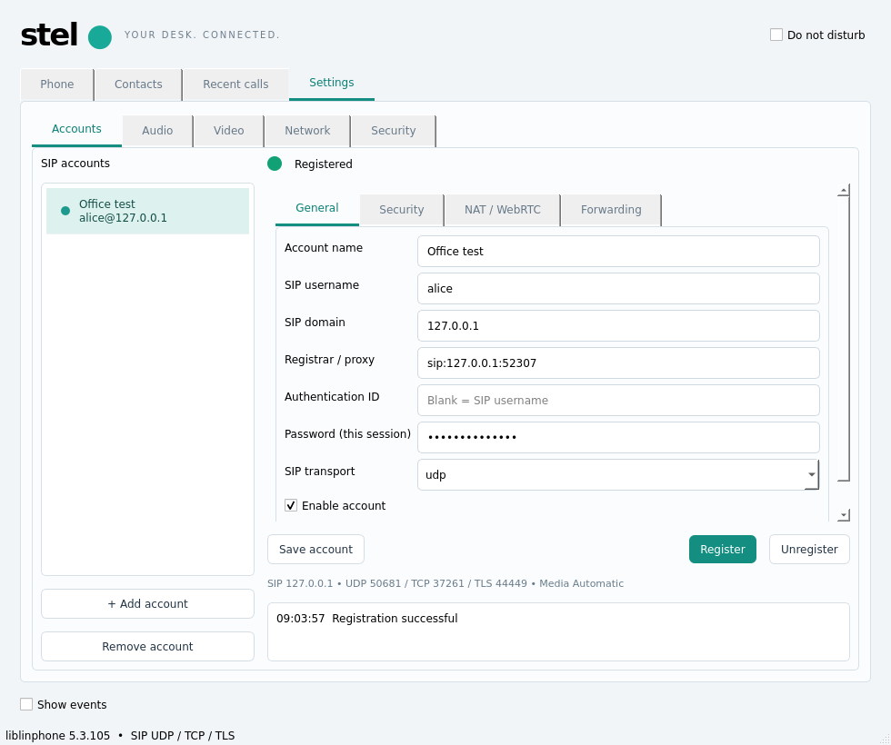
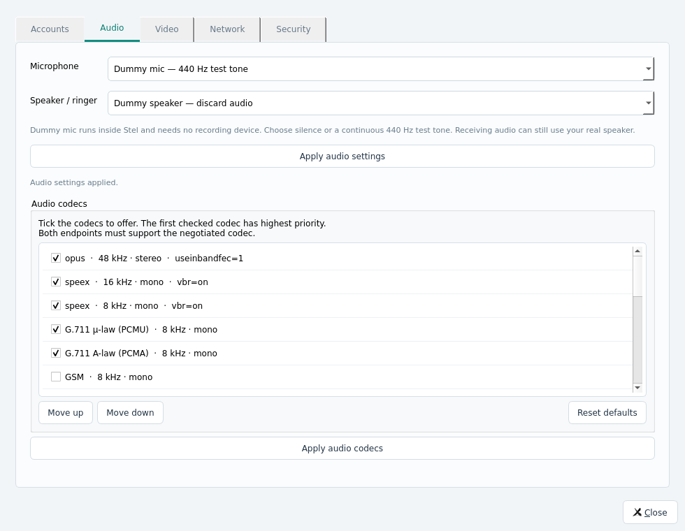
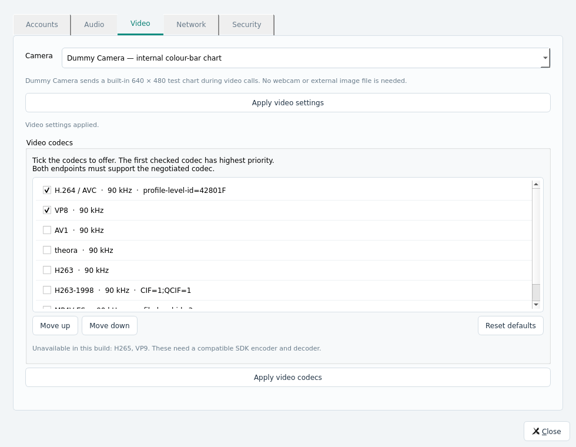
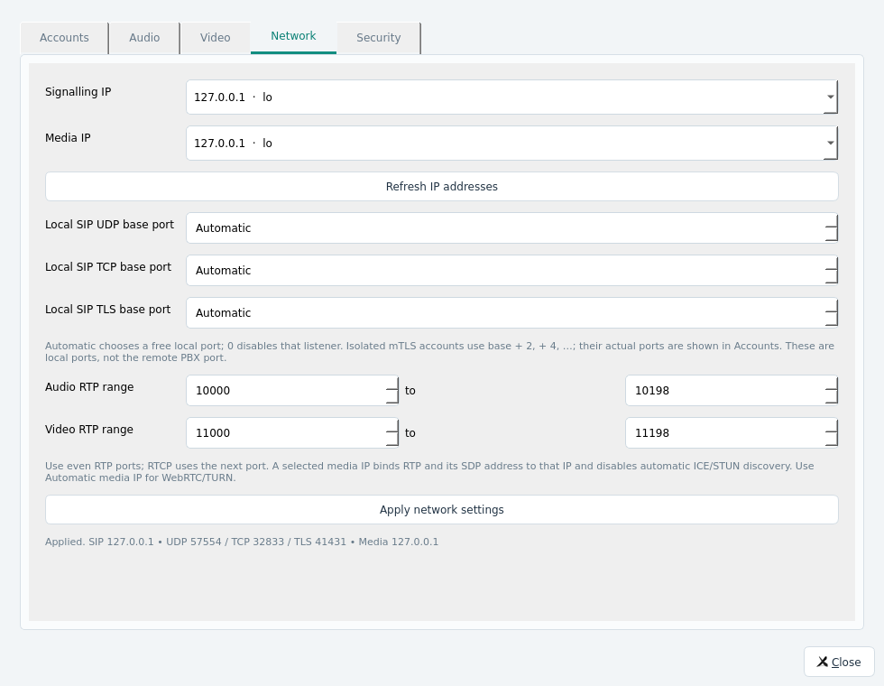

# Stel 0.2.0 — verification on 2026-11-09

Host: Debian 13 x86_64, Qt 5.15.15, liblinphone 5.3.105, GCC 14.2.
The application also builds with Qt 6.8.2. Windows and full static builds remain
unverified, as recorded in the original 0.1.0 report.

## Result

All three native CTest groups pass: `core`, `settings_ui`, and `tls_registration`.
The final native run completed in 20.67 seconds. The UI scenarios also pass on
the real X11 desktop, in addition to the offscreen test platform.

### Accounts and settings

The GUI test clicks the actual Settings controls and exercises:

- Create and save a new account without registering automatically.
- Register against a local UDP SIP registrar; verify the green status only after
  the registrar's successful response.
- Unregister; verify reception of a REGISTER with expiry zero and removal of the
  registered status.
- Edit the account name in the embedded form and save it.
- Return SIP 403 Forbidden from the registrar; verify a failure state, no green
  status, and the server's response visible in the same settings page.
- Delete the account and verify removal from both Settings and the call selector.
- Verify that session passwords are absent from the saved JSON.
- Select/apply Dummy mic, Dummy speaker and Dummy Camera through the GUI.
- Apply separate signalling/media IP controls and restore them from saved JSON.

Screenshots below were taken during successful tests on the host's X11 desktop.
The registered account shown is a local test account, not the production PBX.

### Real dummy media and network binding

The new core integration scenario starts native media streams and verifies:

1. A registered internal soundcard/filter generates 440 Hz PCM without a physical
   microphone; a second internal device supplies silence, and an output device
   discards playback without requiring a speaker.
2. The internal JPEG colour chart is generated and sent as video by the SDK's
   static camera; the peer receives nonzero video RTP.
3. The peer records received audio to WAV; decoded PCM contains a non-silent test
   tone, rather than just RTP keepalives.
4. Signalling binds to 127.0.0.1 and the requested local SIP port. When available,
   a separate non-loopback local IPv4 address is selected for media.
5. A local UDP relay captures the actual INVITE. Its sender is the selected
   signalling IP, SDP `c=` contains the selected media IP, and `m=audio` contains
   the actual allocated RTP port.
6. `getsockname` on the active RTP socket confirms binding to the selected media
   IP, with its port inside the configured audio range.
7. Network changes during a live call, non-local IPs, and overlapping RTP ranges
   are rejected. Network/device settings survive a JSON round trip.

### Existing functionality

Regression checks continue to pass for audio RTP, hold/resume, received DTMF,
mute, WAV recording, SRTP video, DTLS-SRTP + ICE + BUNDLE video, SIP 302
forwarding, blind REFER transfer, attended REFER/Replaces, DND, multiple accounts
and local audio conferencing.

All seven TLS integration scenarios pass: mTLS + SIP Digest registration, two
accounts with distinct verified client certificates against one registrar, an
mTLS-signalled SRTP call with received audio, and rejection of an untrusted CA,
wrong hostname, absent client certificate and bad SIP password.

## Behaviour and deployment boundaries

- Selecting a media IP intentionally pins RTP/SDP and disables automatic ICE/STUN
  discovery. WebRTC/TURN accounts require Automatic media IP.
- Each isolated mTLS core uses the configured SIP base ports plus its own even
  offset. Actual ports are displayed in Accounts. Local mixing/attended transfer
  across different isolated cores still requires PBX-side bridging.
- Audio/video/network changes require no active calls. CA changes require restart.
- Real microphone/webcam hardware, production PBX interoperability and external
  NAT/TURN networks were not validated by these local scenarios.
- The portable bundle still requires the documented OS facilities and glibc
  baseline. It is not a completely static executable. No Windows validation was
  performed on this Linux host.

Detailed native logs are under `build/qa/settings-ctest.log`,
`settings-ui-desktop.log`, `dummy.txt`, and `dummy-native.log`. Final packaged
runtime checks are recorded in `build/qa/settings-bundle-results.json`.

The earlier TLS probe of PBX 192.168.17.12 and generated private test PKI remain
documented in [the 0.1.0 report](TEST_REPORT_0.1.0.md); this update does not change
that server's configuration or claim authenticated PBX testing.
