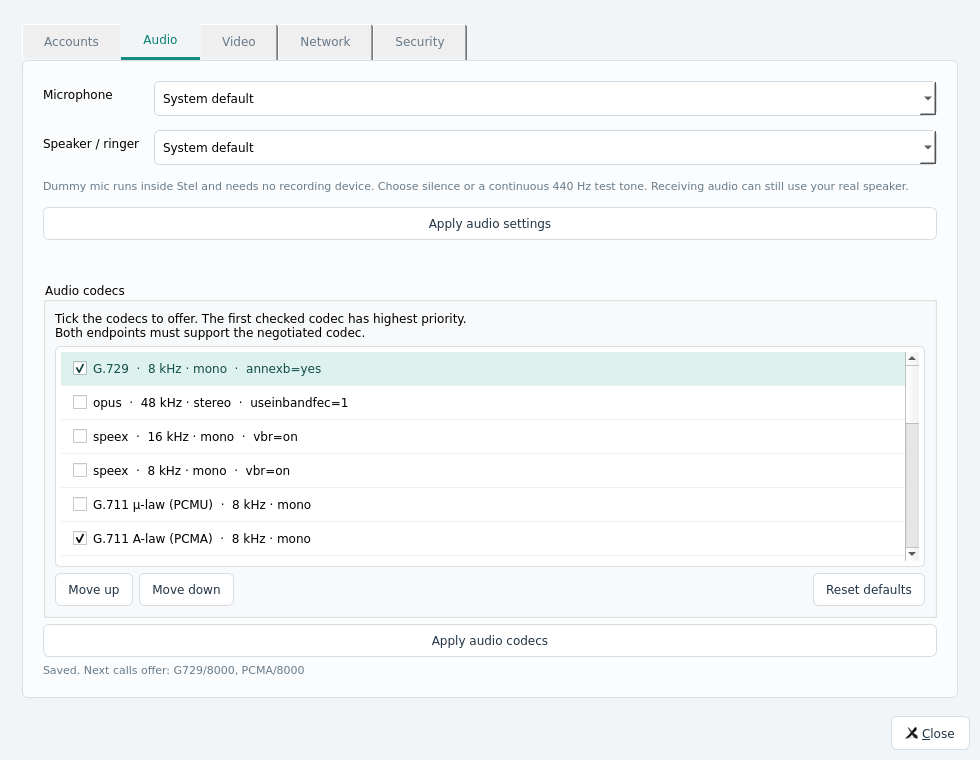
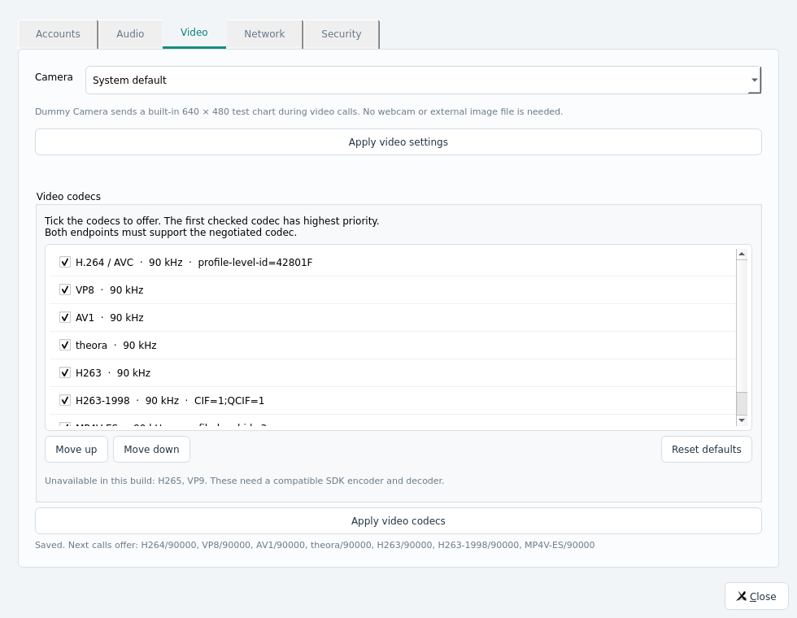

# Stel 0.3.0 — verification on 2026-11-09

Host: Debian 13 x86_64, Qt 5.15.15, liblinphone/mediastreamer2 5.3.105,
FFmpeg 7.1, GCC 14.2. The application also builds and passes a core/UI startup
smoke test with Qt 6.8.2 (using the extracted Qt 6 platform plugin path).

## Codec settings

Settings → Audio and Settings → Video now offer checkboxes, ordered priorities,
Move up/down, Reset defaults, and separate Apply codecs actions. Clock rate,
channel count and receive FMTP distinguish variants. Preferences survive restart.
At least one codec is required for each media type; unavailable codecs and
changes during an active call are rejected. Video ordering uses the SDK's Basic
priority policy rather than automatic codec reordering. New calls and isolated
mTLS account cores receive the policy. The call pane shows negotiated codecs.

### Real audio encoding and decoding

All 19 available audio variants were forced individually in real local calls.
Each case enables only that codec on both peers, establishes native SIP/RTP,
checks the negotiated codec on both peers, and records received audio. The
recorded PCM must contain the generated 440 Hz tone above the silence threshold.

| Family | Tested variants |
| --- | --- |
| Opus | 48 kHz / stereo |
| Speex | 8, 16, 32 kHz / mono |
| G.711 | PCMU and PCMA / 8 kHz |
| G.729 | 8 kHz, annexb=yes, existing bcg729 backend |
| G.722 | 8 kHz RTP clock, wideband audio |
| GSM | 8 kHz |
| G.726 | 16, 24, 32, 40 kbit/s |
| AAL2-G.726 | 16, 24, 32, 40 kbit/s |
| L16 | 44.1 kHz mono and stereo |

### Real video encoding and decoding

All seven video codecs were forced individually on both peers: H.264/AVC,
VP8, AV1, Theora, H.263/RFC2190, H.263-1998/RFC4629 and MPEG-4 Part 2/MP4V-ES.
Each case checks the negotiated codec, incoming RTP, and actual decoded remote
YUV frames reaching an MS2 display sink. This requires no GPU or physical camera.
The sink counts remote frames only; local preview frames do not satisfy the test.

AV1 uses matching upstream MS2 AOM/dav1d filters included in `third_party/ms2-av1`.
The legacy H.263/MPEG-4 filters needed updates for modern FFmpeg context allocation,
packet/frame APIs and H.263 frame sizes; these are included in
`third_party/ms2-legacy`. Their source origins, licences and local modifications
are documented beside the sources. H.264 and VP8 remain the default video codecs;
AV1 and legacy formats are opt-in. H.265 and VP9 have no bidirectional backend in
this SDK build and are explicitly reported unavailable.

## Regression results

The full native CTest run passed all three groups in 71.54 seconds:

- Core: 40 QtTest results passed, including all 26 forced media variants,
  codec validation, ordered policy and persistence, existing media/network,
  hold, DTMF, transfer, forwarding, conferencing and encryption scenarios.
- Settings UI: 5 results passed. Real widgets exercise selection, priority,
  save/reopen, empty-selection rejection and default restoration in addition
  to accounts, registration feedback and dummy/network settings. These also
  pass on the actual X11 desktop; screenshots above come from that run.
- TLS: 8 integration scenarios passed, including a new forced G.729/SRTP call
  between two separately certified mTLS account cores. The runtime codec policy
  is applied after the account cores exist and verified on both call legs.
  CA, hostname, missing-certificate and incorrect-Digest rejection remain tested.

The final portable package was moved to a path containing a space and tested
with development library/plugin paths removed. Its core (40 results), settings
UI (5 results), TLS (8 scenarios), and Settings/core startup smoke tests all pass.
The ELF dependency audit passes for 249 bundled ELF files, with glibc >= 2.39 as
the OS baseline. The same 19 audio and seven video codec cases pass from the
relocated bundle. Results are recorded in `build/qa/codec-bundle-results.json`.
Build and native logs are `codec-build.log`, `codec-ctest.log`,
`codec-ui-desktop.log`, `video-codec-final.log` and `codec-qt6-build.log` under
`build/qa/`. Previous settings and network test details are retained in
[the 0.2.0 report](TEST_REPORT_0.2.0.md).

## Deployment limits

These are local native media tests. Production PBX codec interoperability,
physical hardware and external NAT/TURN networks were not exercised by these
new cases. Codec agreement still depends on the remote endpoint/PBX.

The portable Linux bundle includes the runtime dependency closure and codec
libraries; it requires the documented OS/glibc baseline and is not fully static.
Windows 7/8.1 builds and codec availability there remain unverified on this Linux
host. Other SDKs derive the settings list from their own actual media filters;
the optional MS2 5.3/FFmpeg addons default OFF for those builds.
