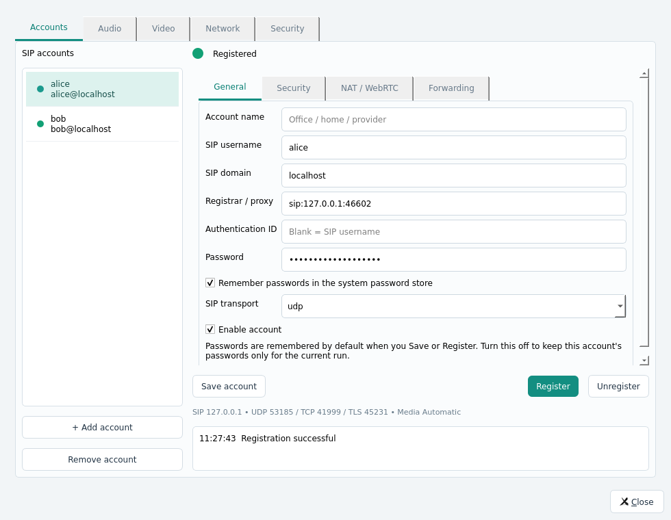

# Stel 0.4.0 — lifecycle, credentials and native packaging

Verified on 2026-11-09, Debian 13 x86_64, Qt 5.15.15 and liblinphone/MS2 5.3.105.
Qt 6.8.2 also builds and passes a real core/UI startup smoke test.

## Changes and causes

Settings previously occupied a tab in the main window; its window close button
therefore closed the application. Settings is now a separate reusable QDialog.
Close, Esc and its title-bar close action return to the main window while both
accounts and active engine state remain alive.

Passwords previously existed only in process memory. Restart restored the
account metadata and registration flags without the Digest password. Passwords
are now remembered by default through QtKeychain, with an explicit session-only
opt-out. Save account and Register save the credentials; there is no separate
Save password step. The JSON file contains no SIP, key or TURN password.
Old session-only passwords cannot be recovered; affected accounts ask for the
password once instead of repeatedly registering with missing credentials.

Main-window close asks once, with Cancel as the default. Confirmed exit stops
certificate child cores before their parent, unregisters accounts, terminates
calls, releases SDK/device/socket references and exits. Saved user accounts and
settings remain. Repeated launches for one configuration directory activate the
existing instance using QLockFile and QLocalServer.

## Authenticated two-account restart test

The actual GUI test uses two accounts and a local registrar that issues SIP
Digest challenges and validates each response. It verifies:

1. Both accounts authenticate and show Registered.
2. Remember passwords starts checked, and no password appears in settings.json.
3. Closing Settings leaves the main window visible and both accounts registered.
4. Cancelling application exit leaves the process and registrations active.
5. Confirming exit produces unregister requests for both users and releases a
   fixed local SIP port.
6. A new MainWindow/core using that same port and configuration retrieves the
   saved credentials and authenticates both accounts again.
7. The temporary test credential entry is deleted after the test.

Additional native coverage restores SIP/key/TURN passwords from the system
store, verifies that JSON omits all three, and verifies that opting out deletes
the saved credential entry. A failed keyring read cannot overwrite the original
credentials with an incomplete snapshot. Plaintext fallback is disabled.

## Native application artifacts

`dist/Stel-linux-x86_64/stel` is an ELF application, replacing the previous shell
launcher. Relative ELF paths and resource/plugin discovery are built in.

`dist/Stel-linux-x86_64.run` is a single native ELF executable containing that
complete application folder. Its small launcher links statically with zlib,
extracts to a private temporary directory, starts the embedded application
without a shell, waits, then removes the directory. No archive program, FUSE,
external Qt installation or user-configured library path is required.
The embedded Qt/SDK application remains dynamically linked inside the container;
this is not a claim that the entire application is statically linked.

The current container is about 107 MiB. Its runtime dependency audit covers 250
ELF files, with glibc >= 2.39 as the documented system baseline. OS display/audio
services and the user's secure credential service remain platform facilities.

`tests/test_portable.py` copies only the single executable into an otherwise
empty directory with spaces and Persian characters, removes development search
paths, and checks native startup, Settings startup, second-instance activation,
no orphan process, extraction cleanup, restart after a stale lock, and rejection
of a corrupted payload checksum. It also relocates the folder release and runs
the real core, GUI and TLS integration suites from there. All cases pass; the
corruption case correctly returns exit status 1. Forced child termination may
leave a small Qt IPC socket until the next launch; the extraction directory is
removed immediately and the next normal run removes the stale socket/lock.

## Results

- Native CTest: all three groups pass in 73.85 seconds.
- Core: 41 QtTest results pass, including all 19 audio and seven video codec
  cases, remembered credentials and existing SIP/media regressions.
- Settings UI: 6 results pass, including two-account authenticated restart,
  dialog close, exit cancellation/confirmation and default remembered passwords.
  These also pass on the actual X11 desktop (screenshots above).
- TLS: all eight scenarios pass, including isolated mTLS certificates and a
  G.729/SRTP call.
- Relocated release: core 41, UI 6 and TLS 8 pass again. The ordinary native
  folder entry works without a launcher script or development environment.

Evidence is in `build/qa/lifecycle-ctest.log`, `lifecycle-ui-desktop.log`,
`lifecycle-qt6-smoke.log`, `lifecycle-package.log`, and
`lifecycle-portable-results.json` with per-case logs beside it.
Previous codec details are in [the 0.3.0 report](TEST_REPORT_0.3.0.md).

## Windows and interoperability boundaries

The Windows build script no longer generates Stel.cmd. It stages the native
stel.exe plus its dependencies and builds a native single-file portable EXE
with a static CRT and uncompressed payload. QtKeychain must match the Qt/toolchain
being used; static application builds also require static QtKeychain.

The full Windows application and Windows 7/8.1 compatibility were not built or
executed on this Linux host. They still require the actual target SDK/toolchain
and target-OS validation. No Windows binary is advertised as tested here.
Production PBX credentials were not used; the new authentication/restart tests
use isolated local Digest registrars and temporary credentials.
