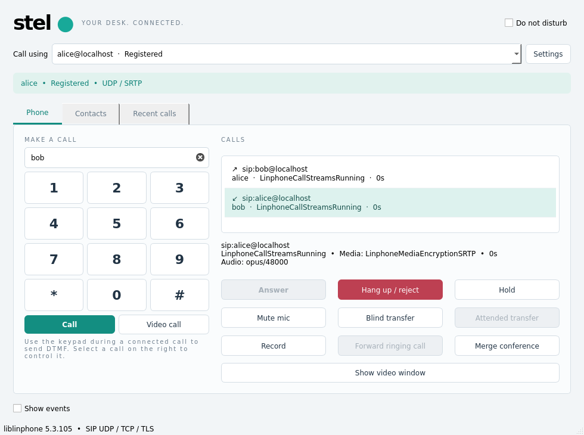

# Stel 0.4.1 — calls between accounts in one application

Verified on 2026-11-09 with Qt 5.15.15 and liblinphone/MS2 5.3.105 on Debian 13.

## Cause and fix

The outgoing and incoming legs of a call between two local accounts share one
Linphone core for ordinary UDP/TCP/TLS registrations. While answering the second
account, the SDK's exclusive media policy terminated the outgoing leg in order
to take the incoming leg. The local regression reproduced exactly that sequence:
OutgoingProgress → IncomingReceived → outgoing End/Released immediately after
Answer, leaving no connected two-leg call.

Answering now recognizes an outgoing call whose peer is the addressed local
account and temporarily selects LinphoneSharedMediaResources for those two
legs. Both remain connected. The tracked references are removed at release and
exclusive mode is restored; ordinary incoming calls keep their existing media
preemption policy. No encryption requirement is relaxed.

Incoming To identities take priority over the SDK's default-account fallback.
This also handles a PBX delivering several registered identities to the same
Contact socket with no username in its Request-URI. Each call row displays its
local account, so the outgoing account and the answering account are distinct.
Call history preserves the final call state instead of replacing it with the
SDK's Released cleanup notification.

The SDK's resource-policy contract is documented in its [public API source](https://github.com/BelledonneCommunications/liblinphone/blob/5.3.105/include/linphone/core.h).

## Native call verification

A local UDP registrar/B2BUA gives each leg its own Call-ID, routes incoming
requests through a userless Contact, and passes real SDK SDP/media between the
registered accounts in one SipEngine. Four cases pass:

| Direction | Media |
| --- | --- |
| Alice → Bob | RTP |
| Bob → Alice | RTP |
| Alice → Bob | Mandatory SRTP + ICE |
| Bob → Alice | Mandatory SRTP + ICE |

Each case verifies the destination account, manual Answer, both legs in
StreamsRunning, incoming audio RTP on both legs, Hold/Resume on both sides,
received PCM recordings containing the generated test tone on both legs, and
hangup/release of both legs. Exclusive resource mode is restored afterward.
The GUI test also performs Call → select the second account's incoming row →
Answer → both rows Connected → Hang up using the real MainWindow buttons.

## Regression and artifacts

The complete native CTest run passes in 88.42 seconds:

- Core: 45 QtTest results, including the four account-to-account call cases and
  all previous codec/media/control/credential scenarios.
- Settings UI: 7 results, including the new real Call/Answer scenario and the
  existing two-account authenticated restart and exit-confirmation scenarios.
- TLS: all eight scenarios, including distinct mTLS identities and G.729/SRTP.

The UI suite also passes on the real X11 desktop. The Qt 6.8.2 application builds.
The same core (45), UI (7) and TLS (8) results pass from the relocated release,
with development paths removed. The single-file release also passes clean
startup, Settings startup, repeated-instance, stale-lock and payload-checksum tests.
The Linux native folder and single-file artifacts are rebuilt as version 0.4.1;
GLIBC >= 2.39 and the existing deployment boundaries remain unchanged. The full
Windows application is still unverified on this Linux host.

Evidence: `build/qa/account-call-account-only.log` captures the failure before
changing media ownership; `account-call-bidirectional.log`, `account-call-ctest.log`
and `account-call-ui-desktop.log` record the successful native tests. Final
relocation/single-file checks are in `account-call-portable-results.json` and
its per-case logs. Test sources are `tests/minipbx.h`, `tests/test_core.cpp`, and
`tests/test_ui.cpp`.

These new calls use a local test PBX and synthetic accounts. The user's live PBX
registrations and passwords were not replaced during testing. An already open
0.4.0 process must be closed normally and the new executable started to load the
fix. Credential persistence and Settings/exit details remain documented in
[the 0.4.0 report](TEST_REPORT_0.4.0.md).
