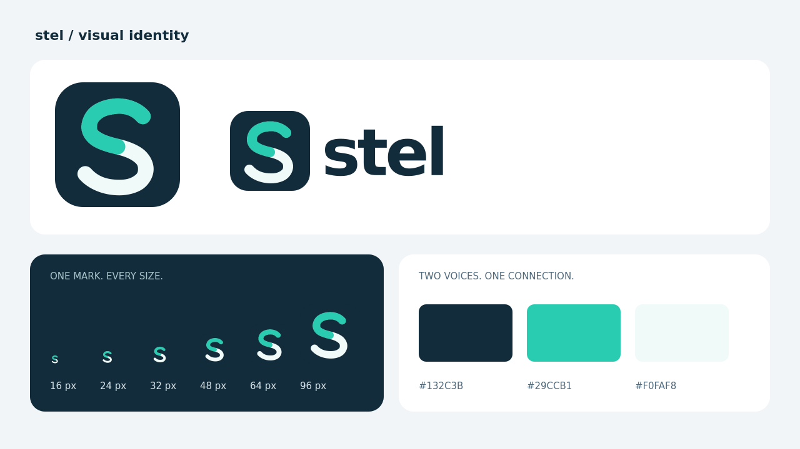
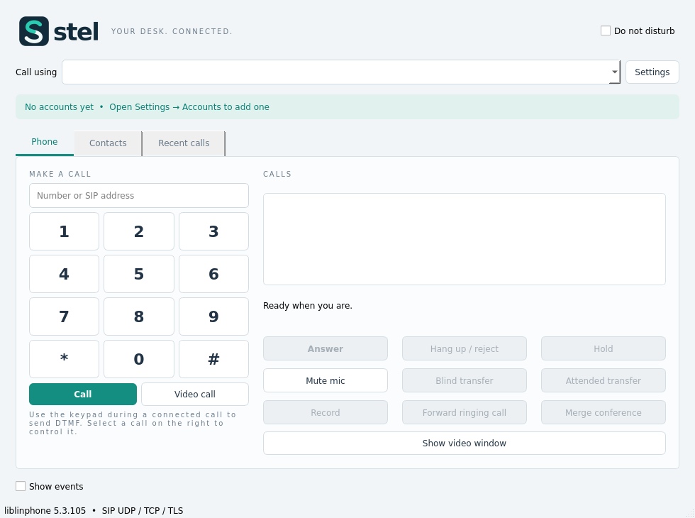

# Stel 0.4.2 — application identity

The original Stel mark is a continuous S in turquoise and ivory on a midnight
blue tile. The two segments represent the two sides of a conversation. The mark
was drawn as editable SVG and checked at sizes down to 16 px.

The outlined wordmark and multi-resolution PNG icons are embedded in Qt resources.
They appear in the header, application/window icon and system tray, including
when the application is launched from its native single-file container. Logo
rendering requires no external image file, installed font or SVG image plugin.
The outlined wordmark uses DejaVu Sans Bold; the font file is not embedded.

The Linux release includes the SVG/scaled hicolor desktop icons and declares its
desktop application ID. This user's applications-menu entry also uses the new
icon. Windows resource scripts attach the multi-size ICO to both stel.exe and
the native portable launcher. Windows compilation/runtime remains unverified
on this Linux host; no Windows binary is represented as tested.

Assets are `packaging/stel.svg`, `stel-wordmark.svg`, `stel-wordmark.png`,
`stel.ico` and the 16–1024 px images in `packaging/icons`. The ICO has nine PNG
frames from 16 to 256 px. Asset dimensions, frame offsets and payload lengths
were verified. See `packaging/BRANDING.md` and `scripts/render-brand.cpp` for
source/regeneration details.

Verification on 2026-11-09: Qt 5.15.15 and Qt 6.8.2 builds pass; the existing
settings/UI suite passes all seven results in 5.62 seconds. The real X11
application screenshot above was inspected. The single-file release was copied
alone into a new directory and launched without development library/plugin
paths; it rendered the same logo and UI successfully. A Qt 6 real core/UI startup
smoke test also passes. Evidence is in `build/qa/brand-ui-ctest.log`,
`brand-build.log`, `brand-qt6-build.log`, `brand-package-smoke.log` and
`brand-qt6-smoke.log`. Previous functional regression coverage is retained in
[the 0.4.1 report](TEST_REPORT_0.4.1.md).

The native Linux release remains self-contained at the application-library level,
with the documented glibc >= 2.39/system-services baseline. Accounts, secure
credential storage and the two-account calling fix are retained. A running older
process must be restarted to display the embedded identity.
