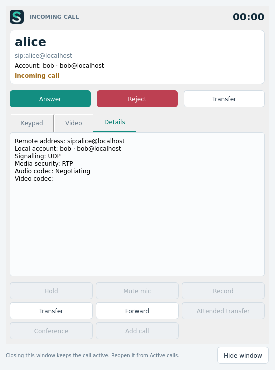
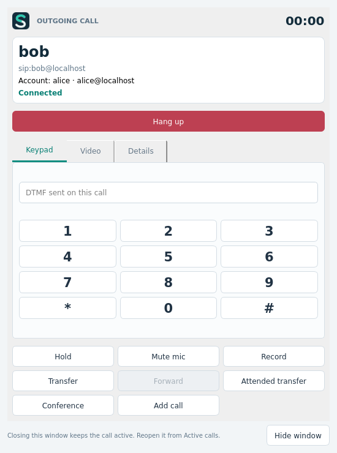
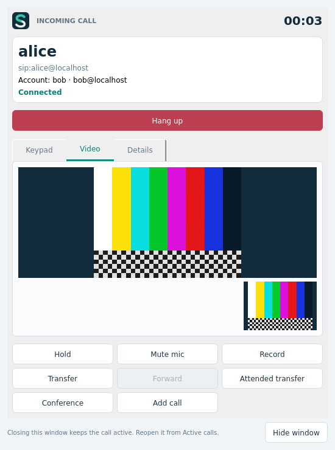

# Stel 0.5.0 — separate call dialogs

Incoming and outgoing calls each open a modeless dialog bound to the call UUID.
The main Phone page retains account selection, the dialer and Active calls.
Closing a live call window hides it and preserves the session; clicking its row
or Open call window restores it. Explicit Reject/Cancel/Hang up ends the session.
Ended dialogs disable controls and close automatically; failed calls show the
SIP failure reason for a longer grace period. Application exit still confirms
and stops SDK media before destroying native video surfaces.

Incoming windows display the caller name, URI, destination account and call
state, with Answer, Reject and Transfer immediately available. Video offers add
an explicit Answer with video option. Ordinary Answer accepts audio only.

Each dialog has DTMF, Hold/Resume, per-call mute, recording, ringing-call Forward,
Transfer, attended transfer, Add call and a selected-peer audio conference.
Transfer redirects an unanswered call with 302 and uses REFER after connection.
Add call waits for Hold to complete before returning to the dialer. Conference
adds only the chosen calls; mute and recording then control conference audio.
Remote video and local preview are embedded in the call's Video tab. Details
show the SIP account/transport, media security and negotiated codecs.

Verification uses real liblinphone calls and SIP/SDP/RTP on loopback, not mocked
call states. Tests use disposable accounts/config directories and dummy devices;
they do not replace registrations on the user's PBX.

- The core suite includes a three-call regression: only two selected paused
  calls are joined and the third stays on hold outside the conference. Per-call
  mute does not change the other independent calls.
- UI tests cover simultaneous incoming/outgoing windows for two accounts in one
  app through a local B2BUA with SRTP/ICE; hide/reopen; Answer/Reject; 302 Forward
  and pre-answer Transfer; connected REFER; DTMF actually received by the remote
  SDK; Hold/Resume and nonempty recording files; consultation REFER/Replaces;
  selected-peer conference, conference mute and recording; failed outgoing calls;
  and incoming/outgoing video negotiation, decoded snapshots, surface IDs, actual
  painted colour pixels and both remote/preview frame delivery. Both audio and
  video are exercised between two accounts in a single application.
- Existing account lifecycle, authenticated restart, settings-close behavior,
  application exit confirmation, dummy devices, network and codec tests remain.
- The TLS suite verifies trusted/untrusted TLS, client-certificate authentication,
  two isolated client identities, and G.729 with SRTP.

Verification on 2026-11-09: the core suite passes 46 results, the expanded UI
suite passes 18 results, and all TLS tests pass. Qt 5.15.15 and Qt 6.8.2 compile;
the Qt 6 application startup smoke test passes. GUI tests also run on the actual
X11 display. Evidence: `build/qa/call-ctest-final.log`, `call-ui-final.log`,
`call-ui-x11.log`, `call-qt6-build.log` and `call-qt6-smoke.log`.

Visual inspection caught a blank SDK XVideo surface on this display. The new
`StelQtVideo` sink paints decoded frames with Qt and uses no XVideo port, GLX
context or QML renderer. A bounded frame cache avoids queuing historical frames.
Both incoming and outgoing tests verify the painted test-pattern colours, rather
than treating RTP traffic as proof that video is visible.

The native Linux release passes the relocated-folder core suite (46 results),
UI suite (18 results) and all 8 TLS scenarios with bundled runtime paths. The
single executable was copied alone to a directory containing spaces/Persian and
passed version/startup, settings, singleton activation, stale-lock recovery,
child/temp-directory cleanup and corrupt-payload rejection. Only the documented
OS base libraries resolve outside the bundle; the ELF closure audit passes.
Evidence: `build/qa/call-package.log`, `call-portable.log` and
`call-portable-results.json`.

Transfer/conference destination panels are scrolled into view after their layout
settles. This has an actual-viewport regression (all 9 focused results pass on
X11), plus a final packaged UI rerun. The packaged native core/probe hashes are
checked against the fully tested release while refreshing the UI binaries.
The final single-file launcher startup is checked again after this refresh.

Known boundaries: local conferencing is audio. Calls in different isolated mTLS
cores need PBX-side conferencing/attended bridging, with a clear error in the UI.
Camera preview is core-scoped in this SDK; the visible video dialog owns its target.
This Linux x86_64 release still requires glibc >= 2.39 and OS display/audio services.
Windows 7/8.1/full Windows compilation and runtime remain unverified on this host.

Previous branding report: [0.4.2](TEST_REPORT_0.4.2.md).
