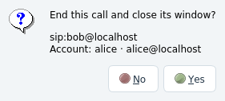

# Stel 0.5.2 — confirm disconnect before closing a call window

Closing an active call dialog through X, Escape/reject or Close window asks
whether to end that call. Yes hangs up/rejects its UUID and closes the dialog;
No preserves both the window and session. No is the default and the escape
response. The former Hide window button and its misleading footer text are gone.
Main application exit retains its separate existing confirmation.

A shared close decision is used by closeEvent and reject, with a guard against
reentrant confirmation. The SDK continues iterating in the question's event
loop. If the remote party ends the call while the question is open, it is
dismissed and the ended window closes without a second hangup. Ended/error
windows close without a question, including their normal expiry timers.

The full Qt 5 UI suite passes 26 results (0 failures) in 25.33 seconds. Native
SIP tests verify No/Yes for audio and video self-calls through the local B2BUA;
Escape/footer/window close; incoming/outgoing ringing; hold; cancellation of
the question by Escape; reentrant reject; remote hangup while the question is
open; and no confirmation for an ended call. Other account, codec, RTP/SRTP,
video, transfer/conference, settings and exit UI tests remain passing.
Evidence: `build/qa/close-call-ui.log` and `close-call-x11.log`.

Qt 5/Qt 6 builds and native release packaging/startup checks are recorded in
`build/qa/close-call-build.log`, `close-call-qt6-build.log`,
`close-call-qt6-smoke.log`, `close-call-package.log` and the packaged UI/single-file
checks. This is a UI lifecycle change; SIP/media backend behavior is unchanged
apart from the application version. Existing OS/runtime boundaries remain in
[the 0.5.1 report](TEST_REPORT_0.5.1.md).
