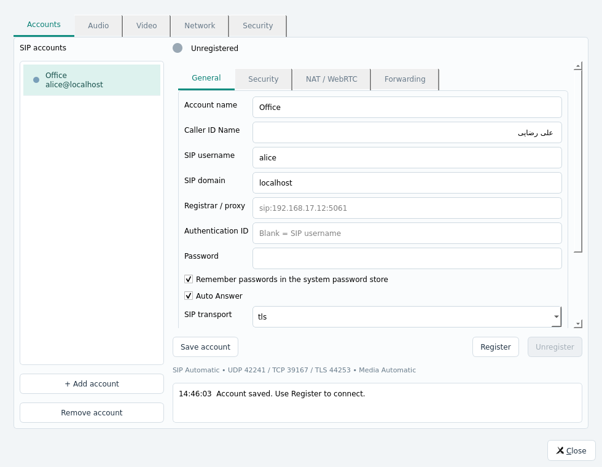

# Stel 0.5.3 — account Auto Answer and Caller ID Name

Settings → Accounts → General now has Auto Answer and Caller ID Name. Both are
stored per account and restored by the account editor and credential-safe JSON
store. Auto Answer defaults off. Incoming automatic answers use audio only;
configured forwarding and Do not disturb retain priority. Calls still open the
normal call dialog and retain the confirmed-close behavior.

The incoming decision is queued outside SDK callbacks and rechecks call/account
state before answering. The normal Answer path handles local two-account shared
media and mandatory media security. Manual rejection or cancellation before the
queued decision cannot resurrect the call or produce a stale-call error.

Caller ID Name is passed to the SDK's SIP identity-address display-name builder,
which serializes From according to
[RFC 3261 section 20.20](https://www.rfc-editor.org/rfc/rfc3261.html#section-20.20).
It is independent of the account-list label, SIP username and authentication ID.
Names can contain UTF-8; quotes/backslashes are escaped by the SDK. Control
characters are rejected. A blank name suppresses the display name. Legacy JSON
without the field inherits the old label, preserving its existing wire identity;
Auto Answer stays off. A PBX may apply its own caller-name presentation policy.

Verification on 2026-11-09: all three CTest groups pass in 121.33 seconds: 62 core results, 28 UI results
and 8 TLS scenarios. New
native tests cover model persistence/migration; real INVITE From headers with
ASCII, Persian, quotes, backslashes, punctuation and blank names; RTP/SRTP auto
answer; disabled auto answer; audio-only answer to a video offer; correct account
selection through the local B2BUA; DND/forward priority; and manual rejection
before the queued automatic action. UI tests verify save/reload/clearing both
options and a real automatically connected incoming dialog displaying the name.
The test B2BUA retains the original forwarded INVITE Via branch for CANCEL and
INVITE retransmissions so unanswered-call cleanup follows SIP transactions.

Evidence: `build/qa/account-options-ctest.log`, `account-options-focused-core.log`,
`account-options-focused-ui.log`, `account-options-x11.log`,
`account-options-qt6-build.log` and `account-options-qt6-smoke.log`.
Qt 5 and Qt 6 compile; the Qt 6 startup smoke test passes. Native package closure,
packaged UI/TLS and single-file startup checks are recorded in the corresponding
`account-options-package*` / `account-options-single-*` logs.

The Linux release retains its documented glibc >= 2.39 and OS-service baseline.
Windows runtime/Win7/8.1 validation remains unverified here. Earlier call-window
behavior and regression evidence are in the [0.5.2 report](TEST_REPORT_0.5.2.md).
